<div align="center">


# Aurora Viewer

**A modern Second Life viewer, written from scratch in Rust.**<br>
A Vulkan renderer, a clean interface, and the Second Life you already know.

[](https://github.com/Aurora-Viewer/Aurora-Viewer/releases/latest)&nbsp;
[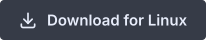](docs/LINUX.md)&nbsp;
[](docs/MACOS.md)&nbsp;
[](https://discord.gg/TK4nbMGmKt)&nbsp;
[](https://aurora-viewer.org)

[](https://github.com/Aurora-Viewer/Aurora-Viewer/actions/workflows/ci.yml)
[](https://github.com/Aurora-Viewer/Aurora-Viewer/releases)
[](LICENSE)
[](https://www.rust-lang.org)
[](#build)

[Why Aurora](#why-aurora) · [Creator tools](#creator-tools) · [Performance](#performance) · [Features](#what-works-today) · [Roadmap](#roadmap) · [Using Aurora](#using-aurora) · [Build](#build) · [Contributing](#contributing)

</div>

**High framerates and low frame time, ultra fast teleports/loading, thanks to modern technologies like Vulkan/Rust.**  
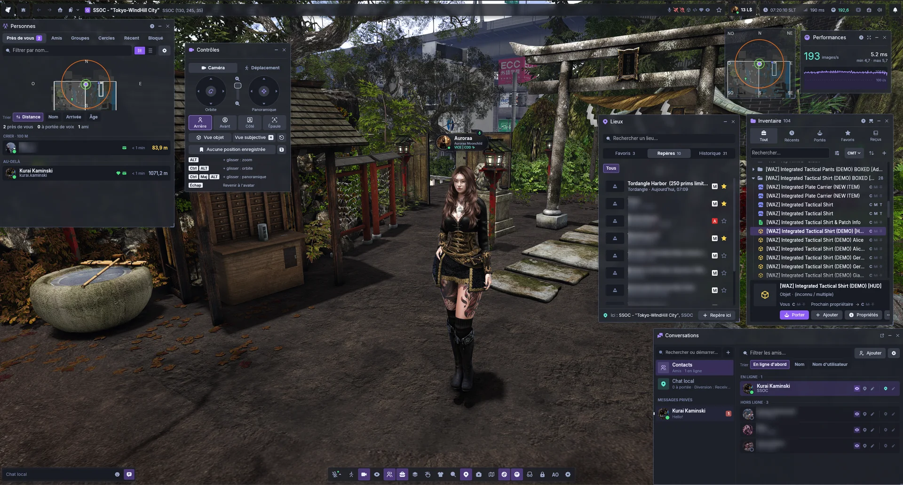  


**All the tools you need to experience SecondLife the way it's meant to be experienced, Photo tools, Auto Hover Height, tons of QoL !**  
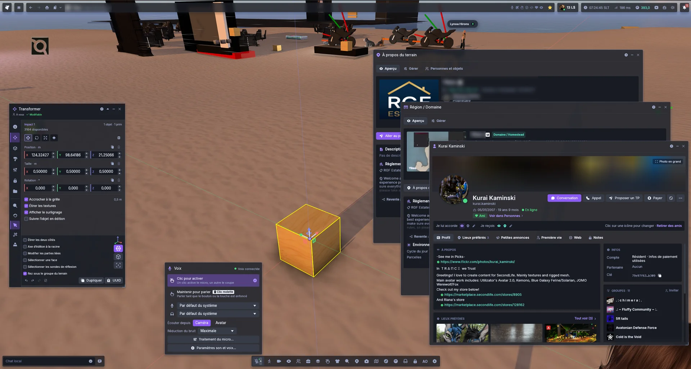  


**Modern UI and Legacy toggles to get the Legacy UI back on the modules you want! (if you prefer).**  
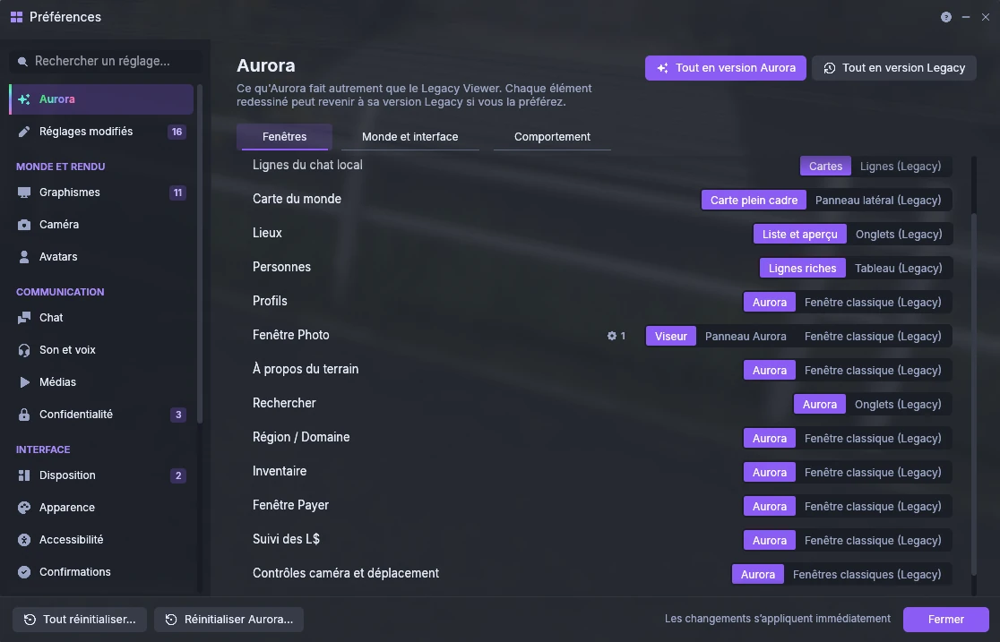  

**New login experience with multi-avatar support.**  
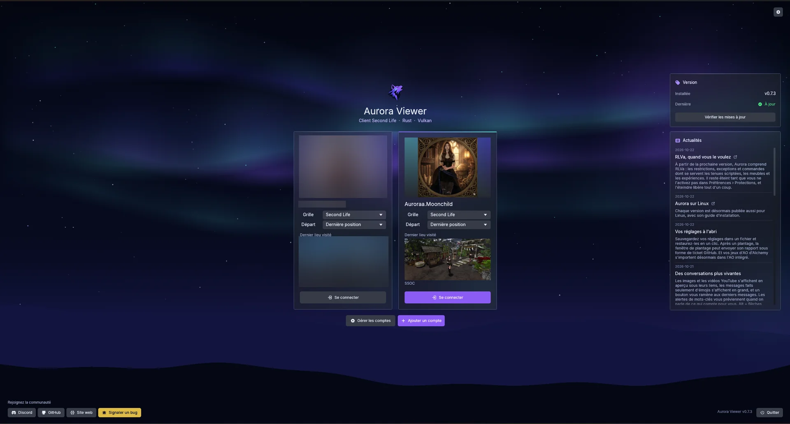  

<details>
<summary><b>More screenshots</b>: conversations, notifications, inventory, places, search and the resource monitor</summary>
<br>
<table>
  <tr>
    <td width="50%" valign="top">
      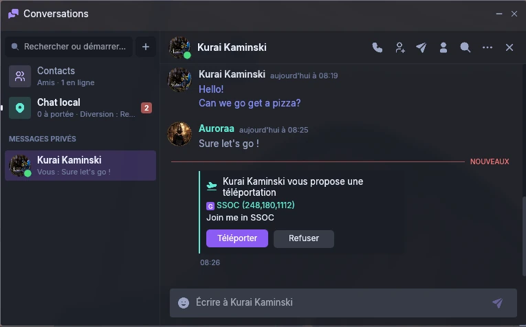<br>
      <b>Conversations</b> like a messenger: bubbles, pictures, and teleport offers or gifts right in the thread.
    </td>
    <td width="50%" valign="top">
      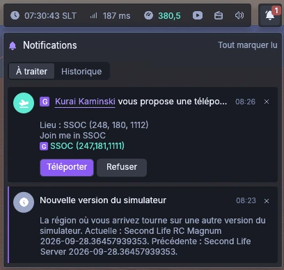<br>
      <b>A notification center</b> that unrolls from the bell, with the history of everything you missed.
    </td>
  </tr>
  <tr>
    <td valign="top">
      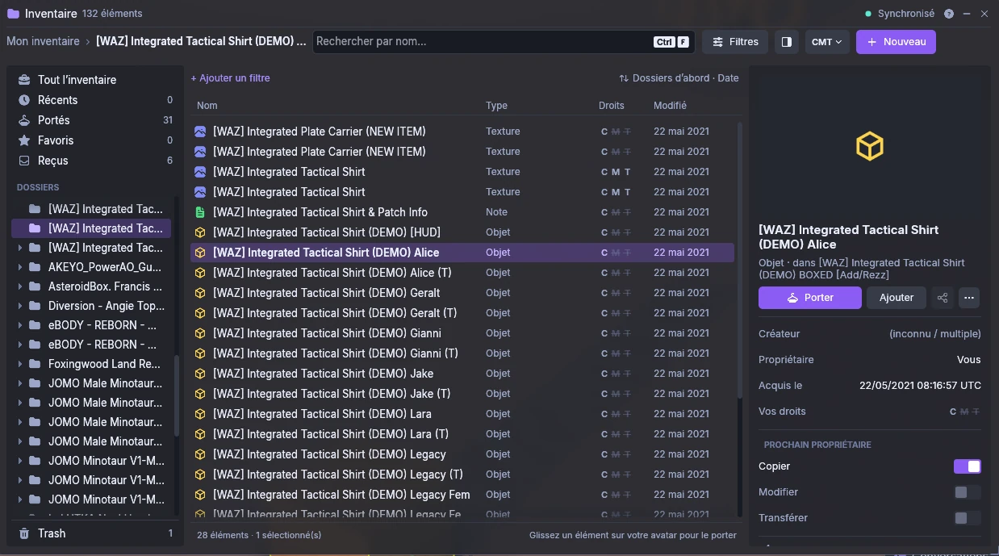<br>
      <b>An inventory</b> that widens into an explorer: folders, details, filters and each item's rights at a glance.
    </td>
    <td valign="top">
      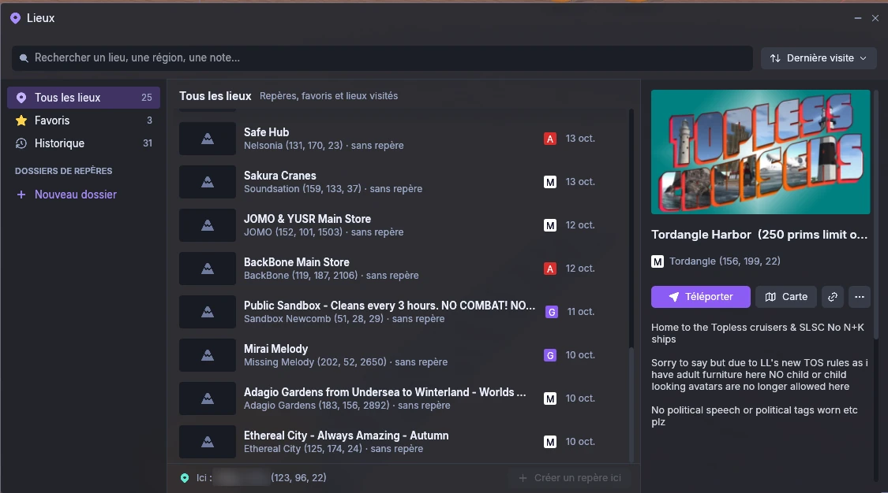<br>
      <b>Places</b>: favourites, landmarks and history in one list, with a preview of each place.
    </td>
  </tr>
  <tr>
    <td valign="top">
      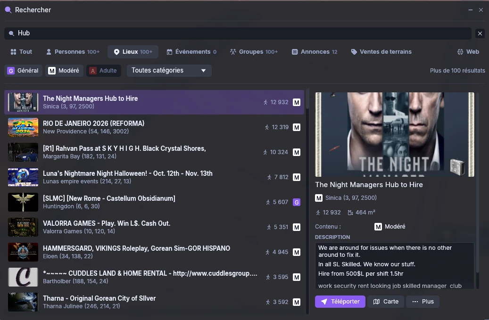<br>
      <b>One search</b> for residents, places, events, groups and classifieds, with the details beside the results.
    </td>
    <td valign="top">
      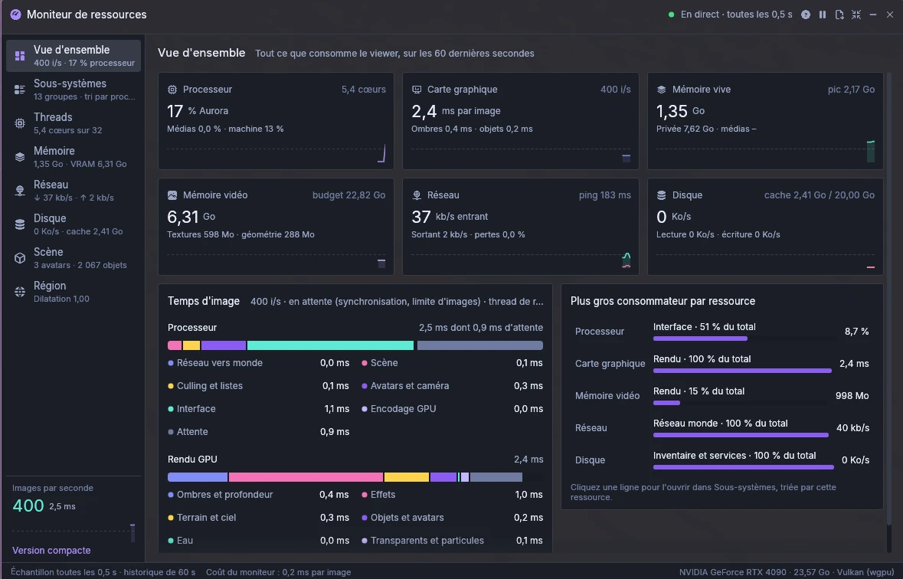<br>
      <b>A resource monitor</b> that shows where every millisecond, megabyte and kilobit goes.
    </td>
  </tr>
</table>
</details>


Aurora Viewer is a Second Life client built from scratch in Rust, with a
modern GPU renderer (wgpu on Vulkan) and a clean, flat interface. It follows
the behaviour of the Legacy Viewer — same protocol,
same rules, same defaults — while rethinking the user interface.

> **Status:** early development (0.x). Usable for exploring, chatting and
> testing. Some implemented features still await live-grid validation — see
> [TASKS.md](TASKS.md).

## Why Aurora

<table>
  <tr>
    <td width="25%" align="center" valign="top">
      <h3>≈ 5×</h3>
      the frame rate of a classic viewer in a busy store
    </td>
    <td width="25%" align="center" valign="top">
      <h3>≈ ½</h3>
      the video memory for the same textures
    </td>
    <td width="25%" align="center" valign="top">
      <h3>Instant</h3>
      teleports within a region, with no loading screen
    </td>
    <td width="25%" align="center" valign="top">
      <h3>Vulkan</h3>
      a renderer built for today's graphics cards
    </td>
  </tr>
</table>

Items marked 
are planned or in progress: they are not in the viewer yet.

### Fast, and smooth

- **Hundreds of frames per second in crowded places.** In a busy store of
  about 16,000 objects, Aurora ran at around 340 fps where a classic viewer
  gave 68, on the same PC and at the same spot
  ([how it was measured](#performance)).
- **The picture keeps moving when you arrive.** Textures and meshes are
  decoded on background threads and written straight into GPU memory, so
  landing in a busy region doesn't freeze the view.
- **Places you know come back at once.** Textures are cached on disk ready
  for the graphics card: back in a place already visited, nothing is decoded
  again.
- **About half the video memory for textures**, with nothing lost to the
  eye: each texture is checked before it is kept compressed.
- **Instant teleports within a region.** The other teleports show your last
  view, blurred, with real step-by-step progress.
- **A graphics card that finally does the work.** It decides by itself what
  is visible and draws thousands of objects in a handful of calls, while a
  dedicated render thread keeps the frames coming.
- **Faster arrivals**: what you are looking at downloads first, and after a
  teleport the region shows about a second sooner. Downloads keep pace with
  your connection, so avatars come out of the cloud about three times
  sooner, already textured.
- **Fewer hitches in a crowd**: avatars, their outfits and changing
  materials are updated without the little stutters of a busy place.
- **It holds on**: a network blip no longer logs you out (Aurora reconnects
  you right where you were), and a full video memory no longer freezes the
  viewer: Aurora stays within the video memory your graphics driver grants it.
- **Your whole inventory, ready**: it loads in the background from login on,
  so its folders are already filled when you open them.
- **Your whole outfit, every time**: every attachment is worn at login and at
  each outfit change, even in a busy region.
- **The right graphics card on a laptop**: on a PC with an integrated and a
  dedicated GPU, Aurora picks the dedicated one, and you can choose the card
  in Preferences, from the login screen on.
- **Fast with a huge wardrobe**: the Appearance window stays smooth with
  thousands of outfits.
-  **AMD FSR upscaling** and its native anti-aliasing, on every brand of
  graphics card.

### A sharper, richer picture

- **Modern ambient occlusion (GTAO)**: soft, accurate shading in corners,
  under furniture and around avatars, which also keeps reflections out of
  the places light cannot reach.
- **Sun contact shadows**: the small shadows that ground feet, objects and
  folds, where shadow maps are too coarse.
- **Clean sun shadows**: no hatching, no stair steps along curved surfaces.
- **Highlights that hold still**: specular anti-aliasing stops shiny
  surfaces from shimmering as you move.
- **Details that stay**: normal maps keep their full strength, foliage,
  fences and hair stay solid in the distance, and textures load as finely as
  you expect close to the camera.
- **Graphics levels matched to your machine**, chosen at first launch: GTAO
  from Medium up, contact shadows from High, screen-space indirect light
  (experimental) in Deluxe with a 192 m draw distance; per-section resets
  when you want to start over. Save your own settings as named graphics
  profiles and switch between them from Preferences or the FPS counter.
- **HDR, or the older look**: the Legacy Viewer's HDR and Emissive switch,
  on by default, in Preferences › Graphics › Image.

### The Second Life you know

- **The same world, the same look.** PBR and legacy materials, EEP skies,
  shadows, reflection probes, mirrors, water, glow and particles, compared
  side by side on the main grid.
- **Nothing to relearn.** The rules, options and defaults you are used to,
  down to the chat commands of the built-in Animation Overrider.
- **Voice, IMs, groups and offline messages**, with a conversation history
  you can search, kept on your disk only. Voice comes with noise
  suppression, echo cancellation and gain control, a speaking glow that
  follows each voice, and a resident's volume at the top of their menu.
- **A well-behaved client.** Aurora speaks to the servers the way they
  expect: same messages, same request rates.
- **Shape and clothing editing**, with 82 body and face controls, textured
  mesh previews and saved copies; the editors of skin, hair, eyes, tattoos,
  alphas and the nine clothing types, previewed on you before you save; and
  manual or automatic hover height to keep your feet grounded.
- **Gestures**, with a manager, an editor, chat triggers, shortcuts,
  animations and sounds; they keep their rhythm, and talk to your HUDs on
  negative channels too.
- **Go to and Follow** a resident from their menu: Follow keeps up when they
  run, take off or land. Its compact window adjusts the target distance and
  stops the follow; an optional teleport resumes following when blocked.
- **Your own sky and water**, with EEP sky, water and day-cycle editors,
  personal previews and parcel or region environment settings.
- **Smoother avatars**: movement of the people around you extrapolated and
  smoothed between two server updates.
- **Mouselook that plays right**: hold the right button to zoom, and
  scripted weapons and HUDs hear your clicks — even a scripted attachment
  worn under a mesh body. Hold Alt to free the cursor and click a window or a
  HUD. Pick your crosshair: a dot, a cross, a circle, the Legacy corners or
  your own picture, with its size and colour.
- **Little comforts**: walk backward without turning around, log back in
  still flying, Quickjump to jump and land without the animation delay,
  animations that pause while you edit an attachment, and Help › Grid status
  to see at once whether the grid has a known problem.
- **Unbox in one click**: copy an object's contents into a new inventory
  folder, or wear them straight away, replacing your outfit or adding to it.
- **Sound Explorer**: find which object plays a sound, preview it, stop it or
  block it.
- **Run your land**: a complete Region / Estate window (people and bans,
  interventions, scripts and physics with Top scripts / Top colliders,
  environment, experiences, covenant, telehub and terrain), in the Aurora
  layout or the classic eight tabs.
- **Livelier water** (experimental, off by default): waves, foam on the
  shores and around what floats, caustics, wakes and an underwater view, each
  effect switched on its own; the built-in AO swims, at the surface and
  underwater.
- **RLVa, when you want it**: the restrictions, exceptions and commands that
  scripted outfits, furniture and experiences rely on (RLV 3.4.3 /
  RLVa 2.4.2). Off by default: turn it on in Preferences › Protections;
  turning it off releases every restriction at once ([details](docs/RLVA.md)).
- **PBR terrain**: regions whose ground uses PBR materials render with them,
  as in the Legacy Viewer, and estate managers preview a ground-cover change
  on the terrain before they apply it.

### A photo mode like a real camera

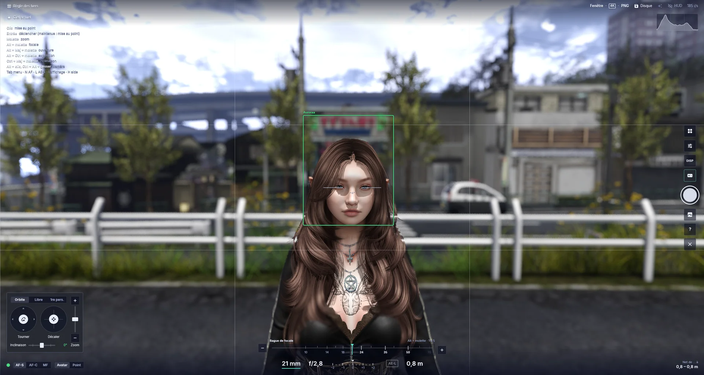

- **A viewfinder, full screen**: the world under a camera's overlay, with
  three display levels from everything to the picture alone.
- **Autofocus that finds faces**: AF-S, AF-C or manual focus. On an avatar
  the focus locks between the eyes and follows them; the AF point turns
  green with a double beep.
- **Lens rings**: focal length, aperture and exposure on rings you drag, or
  on the mouse wheel; Enter is a two-stage shutter.
- **Real depth of field**, on by default, with focus peaking in manual focus
  to see exactly what is sharp.
- **Light under control**: a live luminance histogram, exposure lock (AE-L),
  and a level to keep the horizon straight, or tilt it.
- **A camera that goes where you want**: orbit, free or first person from an
  on-screen camera pad, and a 2 s or 10 s self-timer to get into your pose.
- **Up to 8K**: 4K by default, in PNG, JPEG or BMP, to disk, inventory or the
  profile feed ([how to use it](#photos)).
- **Group photos, sharp**: Shift + click adds every avatar of a group shot
  to the focus, while the background keeps its blur.
- **Pose without leaving the shot**: your HUDs answer clicks in the
  viewfinder, and its Poser button poses the avatar over the shot.
- **Freeze the world**: every avatar, animation and moving thing holds still
  while your camera stays free, to line up the perfect angle on a pose.
- **Camera presets**: save a whole shot by name and bring it back in one
  click: where the camera stands (held by your avatar, at a place, or
  following an object), the lens, the filters and the light.
- **Quiet snapshots**: like the Legacy Viewer, the shutter is heard around you
  and your avatar plays the snapshot animation; one switch keeps both quiet.
- **Isolate your subject**: your avatar alone, or the avatars and objects you
  click, on a transparent background: a PNG ready for a poster or a profile,
  with soft hair and glass kept partly transparent.
- **Filters and effects, live**: the Legacy Viewer's 30 photo filters, 36 of
  Aurora's own (film grain, teal and orange, instant photo, halation, chromatic
  aberration, cinema bars, VHS, glitch, oil paint, sketch…) and your own `.cube`
  LUTs from Lightroom, DaVinci Resolve or Photoshop. Stack up to six, each with
  its strength and its own sliders, and compare before / after with a line you
  drag. Some read the scene's depth: a haze that grows with distance, a true 3D
  miniature, a blurred background, the subject standing out. What you see in
  the viewfinder is what the photo gets, at full resolution.

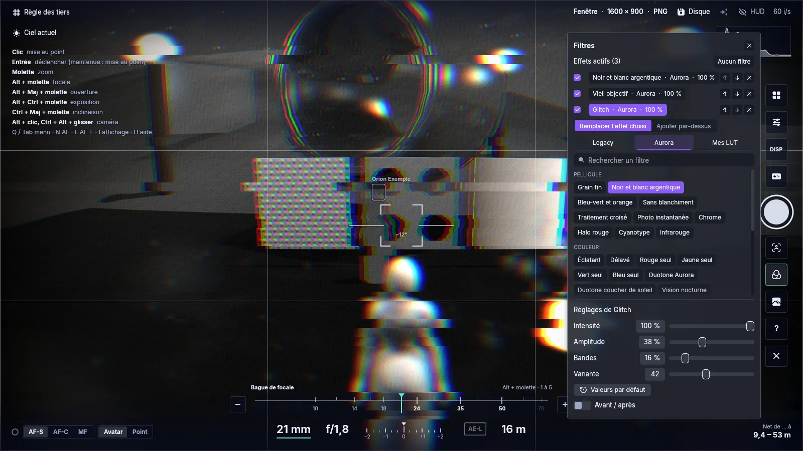

### Creator tools

- **LiveMesh**: see your Blender mesh in the viewer while you edit it, with
  nothing uploaded. Rigged meshes follow your own avatar, with their weights,
  shape keys and materials; static meshes and linksets become local objects
  you can place on the ground, move, rotate, resize, attach to your body or
  HUD and detach. The Blender plug-in ships with the viewer and installs
  itself, with an SL / Bento starter rig, rigging tools and an import with
  its LODs prepared ([details](docs/BLENDER_LIVE.md)). Preview an animation
  on a saved local model, to see Bento tails and wings move.
- **A poser for photos**: pose yourself, your own animesh, or nearby avatars
  who agree to it, joint by joint: body, face, hands, other bones and
  physics, with a Left / Right / Mirror side choice, a finger grid and
  whole-pose actions. Save poses to a library, export them as BVH or import
  them as an animation, with Ctrl+Z / Ctrl+Y as you go. The pose is seen by
  you only ([details](docs/POSER.md)).
- **An IK workbench**: reusable pose projects that keep chosen bones on their
  targets, with contacts that compatible viewers apply to nearby avatars
  ([details](docs/IK_EDIT.md)).
- **Build tools that stay out of the way**: a compact editor you can arrange
  yourself, larger material previews for Blinn-Phong and PBR, a live preview
  of the prim you are about to create, outlines that stay visible while you
  move transparent objects, edit handles you can make bigger, and parcel
  boundary shortcuts in the terrain menus. Default permissions (Inventory ›
  New) apply to everything you create or import.
- **Area search**: find the objects rezzed around you from World › Area
  search or a toolbar button. Search their name, description, owner,
  creator, group or UUID as you type, keep to the current parcel or reach
  into neighbouring regions, filter by ownership, sale, physical, phantom,
  temporary or distance, sort the results, then inspect an object, zoom to
  it or copy its UUID.
- **A particle editor**: Build › Edit particles shapes an effect on the
  selected prim, live, then puts the matching script into it or copies it,
  with no `llParticleSystem` written by hand.
- **Animation explorer**: World › Animation explorer shows which object or
  resident plays an animation on you, previews it on a stand-in avatar, and
  stops it, revokes the object's permissions or blocks it for good.

### An interface made for today

- **Flat, calm and readable**: glass island bars, a notification center with
  history, the Inter font throughout and a redesigned performance window.
- **In English, French and Japanese (日本語)**: the whole interface follows
  your system language or your choice, applied at once. Japanese uses Second
  Life's official Japanese terms (インベントリ, 区画, フレンド…), Japanese
  interface fonts and Japanese dates ([details](#language)).
- **Conversations made for today**: a Contacts tab, conversations you can
  reorder, group pictures, and nearby chat as cards with the speaker's
  picture. Unread conversations flash softly, three dots bounce on the
  picture of a resident typing to you, and an item
  someone gives you appears as a card in their conversation, like the L$ they
  pay you and the L$ you pay them, with the message. A thumbnail per
  open conversation waits beside the chat bar with its unread count, and
  nearby chat can also rise in bubbles above the speakers' heads (off by
  default).
- **Give by dropping**: drop inventory on a conversation, a profile or the
  resident's avatar in the world to give it.
- **Conversations in their own windows**: pop a conversation out, or drag it
  out of the list; nearby chat can live in its own window too. The
  Conversations button flashes when something new arrives, and a right click
  keeps it quiet for nearby chat.
- **Links that show what they point to**: pictures from Gyazo, Flickr,
  Imgur, Lightshot and Reddit pages, Bluesky and X posts, and your own cloud
  or gallery (Nextcloud, Immich…) once listed in Preferences › Chat; short
  videos and a YouTube player that play in the conversation, keeping each
  video's shape and your volume; animated WebP that move like GIFs; and
  `secondlife:///` links shown as names and places in chat, dialogs and
  notifications.
- **Write with ease**: a spell checker with suggestions in the chat bars,
  conversations and notecards, auto-replace (`brb`…) if you like, `@` to
  mention someone in the conversation, names completed as you type, and `/`
  in nearby chat to find and play a gesture. Ctrl+Shift+Enter starts a new
  line, and pasted paragraphs keep their shape. Arabic and Hebrew read right
  to left, in name tags, bubbles, floating text and conversations.
- **Messages that matter, in front of you**: a message an estate manager
  sends to the region shows as a card in the middle of the screen, like a
  friendship offer, and a group notice shows its group, its insignia and
  its attachment, ready to save.
- **Script errors where you look**: your own objects' errors show in red in
  the nearby chat instead of popping a window, and can also go to a chat
  channel for your logger script.
- **GIFs in the conversation**: a GIF picker next to the emoji button, with
  GIPHY and KLIPY. It appears once you add your own free key in
  Preferences › Chat › GIF.
- **Quiet objects, if you like**: messages that do not come from a person can
  take one small line with an icon, and no longer ping you.
- **Emoji at your fingertips**: a keyboard-friendly picker with shortcodes
  like `:heart:`, and Windows Alt codes in every text field. Ctrl+Up brings
  back what you sent, per conversation.
- **Your choice, window by window**: every redesigned window keeps its
  Legacy layout one click away in Preferences › Aurora (bars, people,
  chat lines, inventory, places, search, About Land, Region / Estate, photos,
  controls and more).
- **Arrange it your way**: customizable bottom, left and right toolbars,
  favourites in a menu, row or dock, and windows that move over the whole
  screen.
- **Right-click menus that do it all**: Inspect an avatar, Derender and the
  asset blacklist, invite to a group, add to a contact set, block particles,
  give a calling card, and the object menus' entries working as you expect.
  Arrange the menus of objects, land, avatars, attachments and HUDs yourself.
- **A quick library** (`Ctrl+Space`): textures, PBR materials, objects, animations,
  sounds, notecards, landmarks and scripts from `#Aurora/Aurora Library`, with
  search, folders, favourites and recent use. Check several actual item types
  at once; folder names are only conventions. Objects can be dragged into the
  world to rez, while documents and media use their native editors and players.
- **Notecards in Markdown**: read them formatted, or edit the source beside a
  live preview, with LSL colouring for the code you share.
- **An inventory that grows with you**: the familiar tree at its usual size;
  widen it and it becomes an explorer with a folder column, details and
  filter chips, with columns you resize and choose. Coloured icons by item
  type, and a CMT button that shows your rights, the next owner's, or both.
  A second inventory window opens beside the first to sort between faraway
  folders, and folders opened in their own window get the same layout. The
  Recent tab can cover a set period, such as the last week. Hover an item to
  preview its picture, and build an advanced search from visual rules
  ("objects or scripts, but not no-copy ones"), saved for later, or ask for
  items similar to one.
- **Outfits at hand**: the outfit menu on the outfit folders, and a
  double-click in the inventory to put something on or take it off. Group
  your outfits in folders right from Appearance, in the list and the
  gallery. Drag your tattoo, alpha or universal layers into the order you
  want, and see (and remove) what a script attached to you for a while.
- **One search for everything**: type once and residents, places, events,
  groups and classifieds come back together, with type chips, filters on
  one line and the details beside the results.
- **Places with a preview**: favourites, landmarks and history in one list,
  with parcel snapshots, a star to add a favourite and, widened, folders and
  a preview of the selected place. Hold the back arrow of the top bar to
  list every place of the session and go back in one click.
- **People and places at a glance**: redesigned resident and group profiles,
  a People window for friends, groups, contact sets, recent and blocked
  residents, and a world map with floating controls.
- **Name tags your way**: show or hide your own tag, your friends' and other
  residents' separately, or show them for a few seconds before they fade.
  Your friends' plates take the friends' colour, so they stand out in a
  crowd.
- **Windows that get out of the way**: double-click a window's title to
  collapse it into a movable bar, then restore it with its size and content.
  Hold Alt while dragging to attach windows together; Alt+Shift+U hides or
  restores the interface, Alt+Shift+H the HUDs, and the bars hide
  automatically in mouselook.
- **Ready for your keyboard**: movement keys adapt to the keyboard layout on
  first launch (WASD or ZQSD), and letter shortcuts use the key that carries
  their letter (M is M on AZERTY too). Search Preferences › Shortcuts by
  action, category or key.
- **Made for every eye**: an Accessibility page gathers the settings that
  help (interface scale, text size up to twice the normal size, reduce
  motion, sounds…), with a button on the login screen. A high-contrast palette, the OpenDyslexic font, and
  volume sliders that follow your ear are a click away.
- **Your colours**: pick the accent, window background and text colours in
  Preferences; Aurora keeps them readable.
- **A clock in the bars**, with your local time and its zone, and a balance
  you can hide when you stream or share your screen (right click on it).
- **A clean way out**: on closing, a dialog over a blurred background offers
  Quit, Log out (back to the login screen) and Cancel. Esc cancels; the
  viewer waits for the logout before closing.
- **Updates in one click**: at launch Aurora offers the new version,
  downloads it in the background, checks it against its published hash,
  installs it and restarts your session, and rolls back if anything goes
  wrong. Before you agree, it tells you whether your cache and settings are
  kept. On Linux and macOS it shows the new release instead
  ([details](docs/UPDATES.md)).

### Only in Aurora

- **Portals to walk through**: open a portal to a place, or drop a landmark
  into the world, and walk, run or fly through it to teleport. Other Aurora
  users see it too: your friends by default, everyone if you choose, and a
  portal that appears on someone never pulls them in.
- **Just your parcel, if you like**: hide what stands outside the current
  parcel, everywhere or only on the parcels you list, with exceptions that
  stay visible and options for neighbouring parcels of the same owner or
  group.
- **Immersive mode**: the whole interface hidden but the chat, for photos,
  events or simply enjoying the world; faint buttons bring back the name
  tags, hide your HUDs too, or leave the mode.
- **Aurora team and Linden Lab marks**: their name tags, lists, chat lines
  and profiles show who works on Aurora and who works at Linden Lab.
- **Link safety check**: web links in chat and profiles are marked trusted,
  unknown or dangerous, judged locally with nothing sent anywhere.
- **Parcel permissions at a glance**: the icons show everything, green for
  allowed and red for forbidden, instead of the restrictions only.
- **HUDs you can move and resize**: Ctrl + drag moves a HUD without opening
  the build tools, and scrolling with the same key resizes it — even a
  no-modify one. Sizes are remembered ([details](#huds)).
- **Faces in the conversation**: local chat bubbles show the speaker's
  profile picture.
- **Quiet from far-away objects**: one switch in Preferences › Privacy hides
  the messages of objects outside your region, or outside your parcel. Your
  own objects always get through, your friends' too if you wish.
- **A password that stays safe**: the remembered password is kept in Windows
  Credential Manager, as a hash only.
- **Try it without an account**: an offline demo mode simulates a server
  locally, with no grid connection.
- **Just for fun**: name tags that jiggle like jelly under the pointer, and a
  click combo counter that bursts into northern lights. Both off by default,
  in Preferences › Just for fun.

### Open

- **Free software (GPLv3)**, written from scratch: it is not a fork.
- **Windows, Linux and macOS**: every release has a Linux build
  ([install guide](docs/LINUX.md)), with its sound through PulseAudio or
  PipeWire and the desktop's notifications, and a macOS application for
  Apple Silicon, drawn through Metal, with web pages and video in the world
  ([install guide](docs/MACOS.md)).

## Performance

<table>
  <tr>
    <td width="50%" align="center" valign="top">
      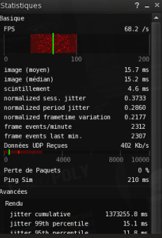<br>
      <b>Legacy Viewer</b> · 68 fps
    </td>
    <td width="50%" align="center" valign="top">
      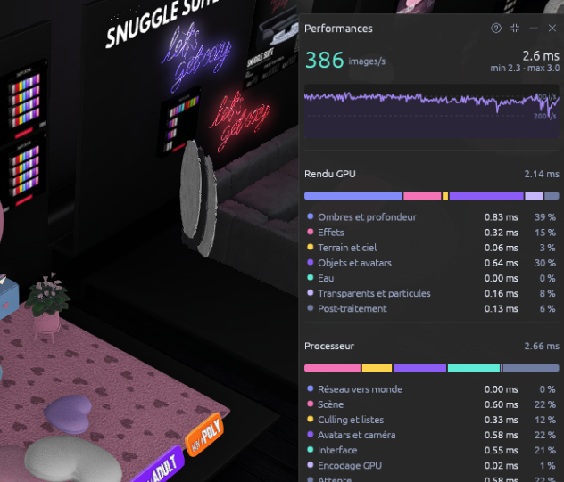<br>
      <b>Aurora Viewer</b> · 386 fps
    </td>
  </tr>
</table>

Measured on 10 October 2026 with the frame cap off, on one PC (RTX 4090), in
one busy store of about 16,000 objects. This is an informal test, not a
benchmark:

- 138 fps where the Legacy Viewer gave 68 fps at the same spot;
- about 343 fps at that spot (median) once the render thread landed, 386 fps
  in the capture above.

The texture memory budget is set automatically from the detected VRAM.

## What works today

- **Rendering** — wgpu / Vulkan, bindless textures, multi-draw-indirect,
  PBR and legacy materials, shadows, GTAO ambient occlusion with specular
  occlusion, sun contact shadows, specular anti-aliasing, reflection probes,
  water, glow, particles, rainbows, 22° halos and depth of field;
  screen-space indirect light, GPU occlusion and enhanced water effects (all
  experimental), graphics presets and per-section resets.
- **Avatars** — skeleton and Bento animations blended like the Legacy Viewer,
  server bakes, rigged mesh, complexity limits, impostors and look-at;
  a shape editor with textured mesh previews, skin, hair, eyes, tattoo,
  alpha, universal and clothing editors with a local preview, manual and
  automatic hover height, Quickjump, rebake, skeleton reset and animation
  controls; gestures with
  playback, editing, chat triggers and shortcuts; mouselook zoom on the
  right button, a free cursor with Alt, custom crosshairs and script controls
  for weapons and HUDs; an Animation explorer; a built-in AO with swimming
  and water walking.
- **[LiveMesh](docs/BLENDER_LIVE.md)** — an optional Blender 2.93+
  plug-in previews geometry, weight and shape-key edits through a local
  connection, without uploading assets. Rigged meshes follow your avatar;
  static objects and linksets can be placed in the world, edited, or attached
  to the body/HUD.
- **Posing** — a [poser](docs/POSER.md) for yourself, your animesh and
  consenting nearby avatars, with a pose library, BVH export and animation
  import; an [IK workbench](docs/IK_EDIT.md) with shared contact profiles.
- **World** — prims, sculpts, mesh with LOD, classic and PBR terrain, EEP environment,
  sky, water and day-cycle editors, world sounds, parcel music and media
  on prims, with Aurora's downloadable media plugins pack; an area search
  for the objects rezzed around you, with filters and sortable results;
  a Sound Explorer with local previews, source camera and sound blocking;
  walk-through portals shared with other Aurora users, with friend/group
  access and protection against portals appearing on top of someone;
  parcel content isolation, a grid status window, and a live particle
  editor.
- **Photos and camera** — a full-screen viewfinder with face autofocus, lens
  rings, focus peaking, a live histogram, exposure lock and a self-timer;
  group focus, HUDs and the poser in the viewfinder; snapshots up to 8K to
  disk, inventory or the profile feed; isolation of your avatar or chosen subjects on a
  transparent background; 66 stackable filters and effects with their own
  sliders, and your `.cube` LUTs; camera presets, a frozen world, quiet
  snapshots; depth of field, a maximum-quality photo mode with 8× MSAA,
  temporary lighting controls, keyboard free camera and a combined camera /
  movement Controls window.
- **Social** — local chat as cards or classic lines, messenger-style IMs and
  group conversations with a Contacts tab, resident profiles, the People
  window, contact sets, blocking, notifications
  with history and friend/IM alerts, region messages in the middle of the
  screen, group notices with their insignia and attachment, inventory offers
  and L$ payments in the conversation,
  a filter for object messages from elsewhere, conversations popped out into
  their own windows, conversation thumbnails beside the chat bar, optional
  chat bubbles above heads, picture, post and video link previews, a GIF
  picker (your own GIPHY / KLIPY key), a spell checker, auto-replace,
  `@` mentions and name and gesture completion, and optional compact lines
  for automated messages; searchable conversation
  history kept on disk per account and grid in the Legacy Viewer's text
  format, and offline messages.
- **Voice** — nearby WebRTC voice, one-to-one, group and conference calls,
  invitations, adding participants and per-participant call volume; echo
  cancellation, automatic gain and noise suppression on the microphone.
- **Groups** — creation, invitations, notices, roles, abilities, member
  moderation, bans, land contributions, L$ accounts and experiences.
- **Land and regions** — redesigned About Land, land purchasing, landmarks,
  the complete Region / Estate window (Aurora or classic eight tabs) with
  Top scripts / Top colliders, parcel script information, parcel / region
  environments, experience permission prompts and region restart alerts.
- **Inventory and commerce** — Aurora's inventory window (tree, explorer and
  details) or the Legacy one, fetched whole in the background at login, a
  second inventory window, resizable columns, advanced searches from visual
  rules and saved searches, picture previews on hover, giving by dropping on a
  profile or an avatar, copying or wearing an object's contents, inventory
  tools, dedicated Marketplace and
  listings windows, compact import launcher and per-type editors; sound
  waveform previews, trimming, gain and splitting.
- **Interface** — in English, French and Japanese; flat Aurora theme, Inter font, Tabler icons, glass island bars,
  customizable bottom and side toolbars, classic layout options, Aurora
  search and Places windows, mini-map, world map, preferences and debug
  overlays; an immersive mode that keeps only the chat; Aurora team and
  Linden Lab marks; double-click walk / run / teleport and content-rating controls
  for places and teleport offers; an Accessibility page, a high-contrast
  palette, custom interface colours, text up to twice the size and the
  OpenDyslexic font.
- **Windows updates** — release checks, cancellable verified downloads,
  installation and restart with rollback. The prompt explains whether cache
  and settings will be preserved, migrated or reset.

Voice calls, photo uploads, environment saving and several group / region
operations are implemented and tested in the offline demo, but still need
end-to-end validation on the main grid. [TASKS.md](TASKS.md) distinguishes
completed work from features awaiting that validation.


## Roadmap

**Not there yet**

- Depth exports and 360° snapshots.
- Automatic updates on macOS (the viewer points to the new release).
- Automatic installation of updates on Linux (the viewer points to the
  new release instead).

Voice is WebRTC only; Vivox is not supported.

**Planned**

- AMD FSR (FidelityFX Super Resolution) upscaling and native anti-aliasing,
  on every GPU vendor.
- Frame Generation (under investigation).
- Compression for the textures that fast BC7 encoding would harm (they
  stay uncompressed and are decoded at each visit).
- The water effects out of their experimental stage.
- Maybe a VR mode with controller support.

The detailed list of what is done, in progress and to do is in
[TASKS.md](TASKS.md).

## Using Aurora

### Accounts and login

The login screen shows your saved accounts as cards, each with its grid, its
start location and a picture of the last place you visited. Click a card (or
press Enter) to connect: a short password prompt appears only when needed,
then the MFA code if the grid asks for it. Left / Right, the wheel or a
horizontal drag browse more than three accounts. With no saved account, the
full login form appears directly; afterwards **Add account** opens it.

Logging in again right after a logout or a crash no longer hangs: the grid
needs a moment to end the previous session, so the login button counts down
the few seconds left (Esc cancels), then connects by itself. Other accounts
never wait.

**Manage** lists the accounts with a search: forget a password or a 2FA
authorization, remove an account, or drag the rows to reorder the cards. Each
account and grid keeps its own password (a hash in Windows Credential
Manager) and, when you tick it, a 30-day MFA authorization.

### Language

The interface is available in English, French and Japanese (日本語): system
language detection, a choice saved in Preferences and applied at once. The
Japanese translation covers every message, with the official Second Life
Japanese terms; it draws with Japanese interface fonts (Meiryo UI, Yu Gothic
UI or MS UI Gothic) and writes dates the Japanese way. Fluent catalogues make
it possible to add a language; see [the translation guide](docs/TRANSLATING.md).

The viewer first follows the language saved in **Preferences › Interface ›
Language**, then the system's if "System language" is selected. English is
the fallback. The change applies at once; the "Language visible to scripts"
setting is on by default, like the Legacy Viewer. The translations are in
`crates/aurora-i18n/locales/`.

### Frame limiter

The frame limiter is enabled at **120 fps by default** and can be disabled
or adjusted in Preferences › Graphics › Smoothness. Saved preferences are
preserved.

### HUDs

HUDs can be moved directly with Ctrl + drag (the key is configurable), without
opening the build tools. Hold the same key and scroll over a HUD to resize it
locally (Shift gives finer steps), including no-modify HUDs. Sizes from 10%
to 800% are saved per account by inventory name and creator, then restored on
new copies. Right-click a HUD to reset its size to 100% or forget its saved
size (the current copy keeps its size). While editing a HUD, scrolling
without the HUD key zooms the entire HUD view, revealing off-screen HUDs
while keeping their saved local sizes.

### RLVa

RLVa is off by default. Turn it on in **Preferences › Protections › Enable
RLVa**: scripted outfits, furniture and experiences can then restrict and
drive your viewer with the RLV 3.4.3 / RLVa 2.4.2 commands. Turning it off
releases every restriction of the session and drops the queued commands;
attachment and folder locks never outlive the session. What is implemented,
command family by command family, is in [docs/RLVA.md](docs/RLVA.md).

### Animation Overrider (AO)

The **AO** button of the bottom bar opens a compact panel: the set, the
previous / next animation buttons of the state being played with the auto
cycle button between them, the AO switch, and swimming or water walking. The
run and flight boosts are in Settings › Movement. Its **Settings** button
opens the full Animation Overrider, with its movement editor and the
animation lists by category (General, Ground, Jumping, Flying, Swimming).
Swimming has its own lists at the surface and underwater. Sets are kept under `#Aurora/Aurora AO`; at first
start, the sets of a Legacy Viewer `#Firestorm/#AO` folder are brought over.
Import a ZHAO notecard from the same folder as its animations. The AO is off at first, as in the Legacy Viewer. `cao on` /
`cao off` turn it on or off; `cao sit` toggles the sit, `cao sit off` replaces
the sit and `cao sit on` keeps the standard sit, like the Legacy Viewer. The demo
scenario is described in
[the test options](docs/TESTING.md#avatars-and-animations).

### Water effects

**Preferences › Aurora › Water** turns on the experimental enhanced water
(off by default): waves, foam, wet shores, caustics, reflections, wakes,
spray and an underwater view, each with its own switch, at the quality you
choose. They are local visual effects: objects and avatars keep the
simulator's physics.

### Shape editor

Open **Appearance › Edit worn shape**, use **Appearance › Edit Shape** in your
avatar's right-click menu, or right-click your worn shape in the
inventory and choose **Edit**. Nine body/face categories and a filter expose the
shape parameters as 0–100 sliders and numeric values, with male/female selection
and height in metres or feet. The images show the minimum and maximum effect on
your body under neutral lighting; clicking one changes the value by one percent. Preview visibility
and height units are remembered. Scroll the wheel over the categories to move
between them. Hints use the worn head, including rigged and static mesh heads,
and retain their images while new assets are prepared.

Changes are previewed locally until **Save**. **Save As** preserves the original
and wears the confirmed copy; Copy permission is required. **Cancel** restores
the current server appearance. Closing a modified shape offers Save, Discard or
Cancel. A shape without Modify is read-only and can only be copied unchanged;
a modifiable no-copy shape can be saved in place.

### Hover height

Open **Appearance › Hover Height** to adjust your height from -3 to +3 m.
Automatic adjustment is off by default. Enable it to estimate ground contact
from your foot attachments and apply your saved offset. A manual height
change disables automatic adjustment; the automatic offset controls keep
it enabled. **Affect camera view** decides whether the camera follows the
height change. Your hover height is remembered per avatar.

### Photos

Open the photo mode from the toolbar or with **Ctrl+Shift+S**. It opens in
the **viewfinder**: the world full screen under a camera's overlay, its
display switched between Full, Essential and Hidden with **I**. Click the
subject to focus: the lens hunts, the AF point turns green on the avatar's
face and beeps twice. **Enter** is a two-stage shutter (held: the focus,
released: the photo), the wheel zooms the camera as usual, Alt + wheel
drives the underlined value of the bottom bar (the focal length at first,
the distance for manual focus with focus peaking), Alt + Shift + wheel the
aperture and Alt + Ctrl + wheel the exposure; Alt + click and the camera's
drags work as everywhere. **N** switches AF-S, AF-C and MF, **V** the
avatar or point area, **Tab** opens the quick menu, **H** the help, and
the dock on the right holds the same for the mouse, with every setting of
the photo panel in a drawer. Without the keyboard: the value chosen in the
bottom bar becomes a lens ring to drag (or − and +), the focus mode and
area are choices at the start of the bar, and the dock's joystick button
shows a camera pad (turn, slide, a spring-loaded zoom rocker, the tilt, and
orbit, free or first person). **L** or the AE-L button holds the automatic
exposure, and the quick menu has a 2 s or 10 s self-timer. The photo panel anchored on the right and the
Legacy Viewer's floater remain in Preferences › Aurora › Photo window.

In the panel, choose a
destination (disk, inventory or profile feed), an aspect ratio and a
resolution. Disk photos support PNG, JPEG and BMP, with presets up to 8K (4K by default).
Inventory uploads use the grid's upload charge; the profile destination
offers a caption and an optional location.

**Photo quality** temporarily raises graphics settings and uses 8× MSAA
for the capture. The window also offers depth of field, exposure, time of
day, cloud pause and worn-light controls. Closing it restores your ordinary
graphics and lighting settings.

**Filters and effects**: the dock's three-circle button (or the **Filters**
section of the photo window) opens the effects panel. Its tabs hold the
Legacy Viewer's 30 photo filters, Aurora's 36 effects in five sections
(film, colour, lens, creative, depth) and **My LUTs**, where **Import a
.cube file…** adds a 3D LUT from Lightroom, DaVinci Resolve or Photoshop;
the search looks in all three. Point at an effect to try it live, click to
use it. **Replace the chosen one** swaps the selected effect, **Add on top**
stacks a new one (up to six): each line of **Active looks** can be switched
off, moved up or down, or taken out. The selected effect's **Strength** and
its own sliders (a glitch's amplitude and bands, a grain's size, a haze's
distance and colour…) are under the list, with **Default values**; your
settings are kept for each effect. **Before / after** puts a line on the
frame that you drag. The depth effects (Haze, Miniature 3D, Background blur,
Subject spotlight) focus where the depth of field focuses, or on the middle
of the photo. The photo is drawn with the same effects, at its resolution.

**Isolate**: the dock's button under the shutter shows **All**, **My
avatar** (alone) or **My choice**: click avatars and objects in the scene to
add or remove them (a whole avatar with its attachments, a whole linkset),
listed by name with a cross each. With a transparent background (the
default) the photo has no sky, ground or water and is saved as a PNG whose
transparency follows the real edges, soft hair included.

Enable **Free camera** to move the camera with the movement keys while your
avatar stays put. Hold the right mouse button to look, use Shift to move
faster or Ctrl to move slower, and press Escape to return. The **Controls**
window provides camera and movement pads, saved camera positions and free
camera controls. A classic Legacy photo layout is available in
Preferences › Aurora.

### Gestures

Open the gesture manager with **Ctrl+G** to activate, play or edit gestures.
Gestures can combine animations, sounds, chat messages and waits, with chat
triggers and keyboard shortcuts. Active triggers complete inline in local
chat; activation is also available from the inventory's right-click menu.

### Notecards

Notecards show images, landmarks and other embedded items with their icon and
name in the text. Drag an item from the inventory to insert it; a left click
opens it directly, and the right click offers Open or Copy to inventory. Save
(Ctrl+S) keeps their permissions. The demo scenarios are described in
[the testing guide](docs/TESTING.md#interface).

### Script editor

The editor offers `Ctrl+K` (or `Ctrl+/`) for line comments, `Ctrl+Shift+K`
for block comments, and Tab / Shift+Tab to indent or outdent the selected
lines. The arrows in the margin fold the blocks between braces; the Edit menu
offers Collapse all / Expand all.

### Toolbar buttons

Right-click a toolbar and choose **Toolbar buttons…** to open the command
catalogue. Drag buttons onto the bottom dock / bar or the left and right
bars, between bars, or along a bar to reorder them. Empty side bars show
drop zones while dragging a button. Right-click a button to remove it, or
drop it back into the catalogue.

Each bar has its own alignment, button sizing and icon / label mode. The
chosen buttons, order, styles and lock are shared by all accounts in the
same local profile. The catalogue also restores the defaults or clears all
bars. An older per-account layout is adopted from the first account used
after the update. Preferences › Aurora offers the glass island and classic
bar layouts, including where favourites appear.

### Inventory

Aurora's inventory opens as the usual tree. Drag its edge, or use the widen
button in its title bar, to get the explorer: the folders move to a column,
then a details pane, filter chips and a status bar appear. The **CMT** button
chooses which rights each row shows: yours, the next owner's, both or none.
Preferences › Aurora › Inventory brings back the Legacy window.

The inventory's right-click menu offers "Move to…" for a folder, an item or a
multiple selection. Type a name in the window's filter, choose the
destination folder then confirm with Move.

### Reporting a bug during the alpha

The bug icon in the top bar, the Help menu, the login screen and the "Send a
crash report" button after a crash open the project's
[GitHub issue forms](https://github.com/Aurora-Viewer/Aurora-Viewer/issues/new/choose)
in your browser; a GitHub account is needed. Choose the bug report template
and describe what you were doing and what happened. After a crash, "Copy
trace" and "Open report folder" in the same window give the technical
details: the full trace may contain personal paths, review it before sharing.
The bar button can be hidden in Preferences › Interface.

Ideas and feature requests go to the
[feedback board](https://feedback.aurora-viewer.org), where everyone can vote
for them.

### Where your files are

Logs are in `%LOCALAPPDATA%\Aurora\AuroraViewer\data\logs\`; each
viewer writes its own (`aurora-<pid>.log`), so several viewers open at once
do not overwrite each other's.

Conversation history (plain text, one file per conversation) is in
`%APPDATA%\Aurora\AuroraViewer\config\accounts\<account id>\chat_logs\<grid>\`;
Preferences › Chat shows the folder, turns logging off and erases it. These
files never leave the machine and are never attached to a bug report.

## Under the hood

**What it is**

- A Second Life viewer written from scratch in Rust; it is not a fork of
  an existing viewer's codebase.
- It speaks the same protocol as the Legacy Viewer (same messages, capabilities,
  request rates and defaults), so the servers see a well-behaved, familiar
  client.
- Open source (GPLv3), with credit to the Linden / Firestorm code
  it ports logic from (see [NOTICE.md](NOTICE.md)).

**Rendering engine**

- Vulkan (through wgpu) instead of OpenGL.
- The GPU does the heavy lifting: it decides what is visible (culling in
  compute shaders) and builds its own draw lists.
- Bindless textures and multi-draw-indirect let thousands of objects be
  drawn in a handful of calls.
- A dedicated render thread draws frame N while the main thread already
  prepares frame N+1.
- Texture and mesh decoding runs on background threads and writes straight
  into GPU staging memory, so arriving in a busy region doesn't freeze the
  picture.
- Textures are kept BC7-compressed in video memory when that leaves them
  visually intact (each one is checked), about half the texture memory
  overall, and cached that way on disk: back in a place already visited,
  they go to the GPU without being decoded again.
- Same look as the Legacy Viewer: PBR and legacy materials, EEP sky, shadows,
  reflection probes, mirrors, water, glow and particles, checked side by
  side on the main grid.
- Then modern screen-space techniques on top: GTAO ambient occlusion
  (XeGTAO) with bent-normal specular occlusion, contact shadows, specular
  anti-aliasing, coverage-preserving mips for cut-out textures and
  per-vertex MikkTSpace tangents.

## Build

Requirements: Windows 10/11, [Rust](https://rustup.rs) (stable, selected
automatically by `rust-toolchain.toml`), a GPU with Vulkan support. On Linux,
see [Installing on Linux](docs/LINUX.md#building-from-source); on macOS,
[Installing on macOS](docs/MACOS.md#building-from-source).

**Development environment:** create a folder for the project, clone this
repository into it, then double-click **`aurora-tools.cmd`**:

```bat
git clone https://github.com/Aurora-Viewer/Aurora-Viewer aurora-viewer
```

The tools check the environment and offer to **repair** it: they install
whatever is missing (GitHub CLI, the Visual Studio C++ tools, Rust), clone
the Legacy Viewer sources next to the repository, and download the Rust
toolchain and the crates. Then, driven by the keyboard: release /
dev / debug viewers, demo, agents' tasks, disk, logs, live pull requests with
Windows notifications, releases (see
[HUMANS.md](HUMANS.md)).

Without Git yet, this command (in a command prompt, in the project folder)
installs everything, Git included:

```bat
powershell -NoProfile -ExecutionPolicy Bypass -Command "$f = Join-Path $env:TEMP 'aurora-setup.ps1'; irm https://raw.githubusercontent.com/Aurora-Viewer/Aurora-Viewer/main/scripts/setup.ps1 -OutFile $f; & $f"
```

Or by hand, to build the viewer only:

```powershell
git clone https://github.com/Aurora-Viewer/Aurora-Viewer aurora-viewer
cd aurora-viewer
cargo build --release -p aurora-viewer
./target/release/aurora-viewer.exe
```

Run the same checks as the CI with `./scripts/check.ps1` (rustfmt, clippy
with warnings as errors, tests). Day-to-day development uses the default
profile (`cargo run -p aurora-viewer`): it behaves like the release build
without its slow link-time optimization. `./scripts/build-release.ps1`
builds GitHub's latest `main` with `--release` into `..\RELEASE\`.

Every build carries the emoji font (Noto Color Emoji, 10.7 MB) inside the
exe, so the exe works from any folder.

### macOS

Apple Silicon Macs draw through Metal (`aurora_render::BACKENDS`), Windows
and Linux through Vulkan; MoltenVK is not used. Building, the application
bundle and its signing: [Installing on macOS](docs/MACOS.md). The macOS
workflow (`.github/workflows/macos.yml`) checks every pull request with
clippy on a Mac, and the merge queue runs the tests and draws a demo frame on
an Apple GPU.

### Versions

The **Git tag is the reference for the viewer's version**: `v0.2.0` gives
`0.2.0` everywhere (title, interface, logs and network clients). Between two
tags, `0.2.0+7.gabcdef123` gives the number of commits and the short
identifier. The version of the crates in `Cargo.toml` is not the viewer's
number. A source archive without Git can be built with
`AURORA_VERSION_TAG=v0.2.0`; otherwise it identifies itself as
`0.0.0+0.gunknown`. The Release workflow checks the version announced by the
exe before publishing; the local build also writes it to `version.txt`.

### Command line

| Argument | Effect |
|---|---|
| `--title <text>` | Names the window "Aurora Viewer <version> - <text> (Dev)" and its log file |
| `--fps-limit <fps>` | Caps this instance at 1–500 fps without changing saved preferences |
| `--language <code>` | Forces the language of this instance (`en`, `fr`, `ja`, or another language added to the catalogues), without changing the saved choice |
| `--grid <name>` | Selects the login grid: `agni`, `aditi`, a saved grid name/nickname or a login URI (`--loginuri <uri>` too) |
| `--login <first> <last> <password>` | Logs in with this account as soon as the login screen opens |
| `<slurl>`, `--url <slurl>` | Starts at this place, or hands it to the viewer already running; must come last |
| `-h`, `--help` | Shows the help |
| `-V`, `--version` | Prints the built version then exits, with no window, log or network |

- `--title`: the build profile ends the title (Dev, Release, Debug); the log
  file is `aurora-<text>.log` (`aurora-demo-<text>.log` in demo mode).
- `--fps-limit`: applies an extra limit to this process, including captures
  and online sessions; a lower user preference remains effective.
- `--language`: also accepts `--language=fr`. An unavailable language falls
  back to English; the argument is meant for demos and screenshots.
- `<slurl>`: `secondlife://Region/x/y/z`, `hop://grid:port/Region/x/y/z`,
  `x-grid-location-info://grid:port/region/Region/x/y/z`, a `maps.secondlife.com` link or a
  `secondlife:///app/…` command (`-url` as the system's link handler passes
  it). Nothing after it is read, so a link from a web page cannot add other
  options. Before login the place is the start location of the next login
  (the saved choice stays); in the world it opens the place's details; a
  command runs once in the world. When a viewer already runs (same demo
  mode and `--title`), the link goes to it and the new process stops.
  Preferences › Language and updates › "Open SLURL and Hypergrid links in Aurora"
  registers all three schemes for the current Windows user. Manage saved grids
  from the login grid menu or Preferences › Network and cache › Manage grids.
- `--login`: the account follows the usual "remember" choices; a single
  user name is written `<name> Resident`. `--grid` alone selects the grid of
  a new account's form.

### Demo mode and test switches

The offline **demo mode** simulates a server locally (a plaza, avatars,
objects, chat, notifications…): no connection, no account. It keeps its own
settings and cache (`…\config\demo`, `…\cache\demo`).

```powershell
$env:AURORA_DEMO = "1"
cargo run -p aurora-viewer
```

| Variable | Effect |
|---|---|
| `AURORA_DEMO=1` | Offline demo mode |
| `AURORA_DEMO_<NAME>=…` | A demo scenario: a window, a stress scene, a camera script… |
| `AURORA_DEMO_PIE=1` / `0` | Forces the pie menu / the list menu in the demo, without changing the preference; combine with `AURORA_DEMO_RCLICK` |
| `AURORA_CAPTURE=<file.png>` | Saves a capture of a frame |
| `AURORA_PROFILE=1` | Writes one profiling line per second to the log |

The compact build inspector also accepts `AURORA_DEMO_BUILD_TAB=transform|shape`;
`object` remains an alias for the transformation section. Window redesign
scenarios use the existing inventory, appearance, land, profile, environment
and preferences switches listed in [docs/TESTING.md](docs/TESTING.md).

Local and editing HUD zoom scenarios (`AURORA_DEMO_HUDS=scale|scale-copy|scale-touch|scale-reset|scale-forget|scale-ctrl|scale-key|scale-secondary|edit-scroll`)
are described in [the testing guide](docs/TESTING.md#huds).

The script editor demos (`AURORA_DEMO_SCRIPTS`): `close-brace` /
`object-close-brace` check the outdent of closing braces; `colors`,
`color-picker`, `color-accept` and `color-cancel` show the RGB vectors and
the shared colour picker; `comment-lines`, `comment-block`,
`multiline-indent`, `multiline-outdent`, `folding` and `object-folding` check
the comment, indent and folding actions offline.

The full list of switches (demo scenarios, captures, forced settings,
diagnostics) and how to read the profiling output are in
[docs/TESTING.md](docs/TESTING.md).

## Contributing

This repository is worked on by humans together with AI agents, each agent on
its own task in its own git worktree:

- [AGENTS.md](AGENTS.md) — rules for AI agents (testing, safety, PRs, reviews)
- [HUMANS.md](HUMANS.md) — how the repository works for humans
- [ARCHITECTURE.md](ARCHITECTURE.md) — scope, crates and file layout
- [TASKS.md](TASKS.md) — what is in progress and to do; finished work is in
  [docs/TASKS_ARCHIVE.md](docs/TASKS_ARCHIVE.md)
- [docs/BRANDING.md](docs/BRANDING.md) — palette, logos, icons and UI rules
- [docs/TESTING.md](docs/TESTING.md) — test switches (demo scenarios,
  captures, diagnostics) and profiling
- [docs/HAND_CONTACTS.md](docs/HAND_CONTACTS.md) — local motorcycle wrist
  contact prototype and the creator's LSL script
- [docs/IK_EDIT.md](docs/IK_EDIT.md) — frozen-pose skeleton editor, target-prim
  offsets and general bone-contact authoring for LSL

Behaviour follows the Legacy Viewer: its sources are expected next to the repository
(`../phoenix-firestorm`, cloned from
[FirestormViewer/phoenix-firestorm](https://github.com/FirestormViewer/phoenix-firestorm)).

Questions and ideas are welcome on [Discord](https://discord.gg/TK4nbMGmKt).

## AI use

Aurora is made by people: developers, QA testers who test each version on
the grid, a project manager, a community manager and moderators. Some
contributors use AI coding assistants to help write code, and we say so
openly.

- **No AI in the viewer you download**: no AI feature, no AI model, nothing
  sent to an AI service.
- **AI never sees your password**: the AI tools run only on the developers'
  computers while they write code. Your password goes from your computer to
  Linden Lab, and nowhere else.
- **[AGENTS.md](AGENTS.md) is not part of the viewer**: it holds the
  guidelines for contributors who use AI, so that those tools follow strict
  rules. Its first rule forbids them to connect to Second Life or to handle
  any user name or password.
- **No AI-generated art**: images, sounds, icons and design are made by
  people.
- **Every change is tested by a person** before it is merged, then by QA
  testers on the grid.

Questions and answers, and the details:
[AI use policy](https://aurora-viewer.org/ai-policy/).

## Privacy

The Aurora team runs no server: the viewer talks to Linden Lab, and to other
services only for the features you use. The
[privacy policy](https://aurora-viewer.org/privacy/) lists what is sent, to
whom, and what stays on your computer; it is also linked from Preferences ›
Privacy. Questions about it: [contact@aurora-viewer.org](mailto:contact@aurora-viewer.org).

## License

Aurora Viewer is free software under the
[GNU General Public License v3](LICENSE). Parts of it are ported
from the Second Life viewer and Firestorm (originally LGPL 2.1); see
[NOTICE.md](NOTICE.md) for details and third-party licenses.

Aurora Viewer is not affiliated with Linden Lab or the Firestorm project.
Second Life® is a trademark of Linden Research, Inc.
