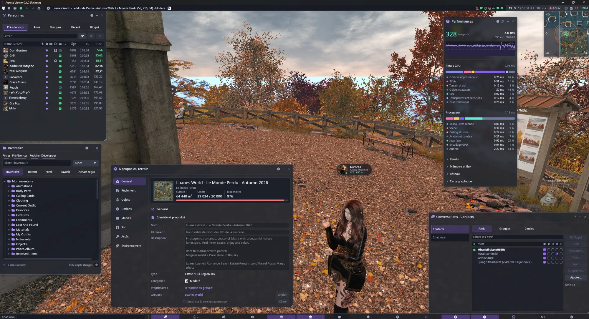
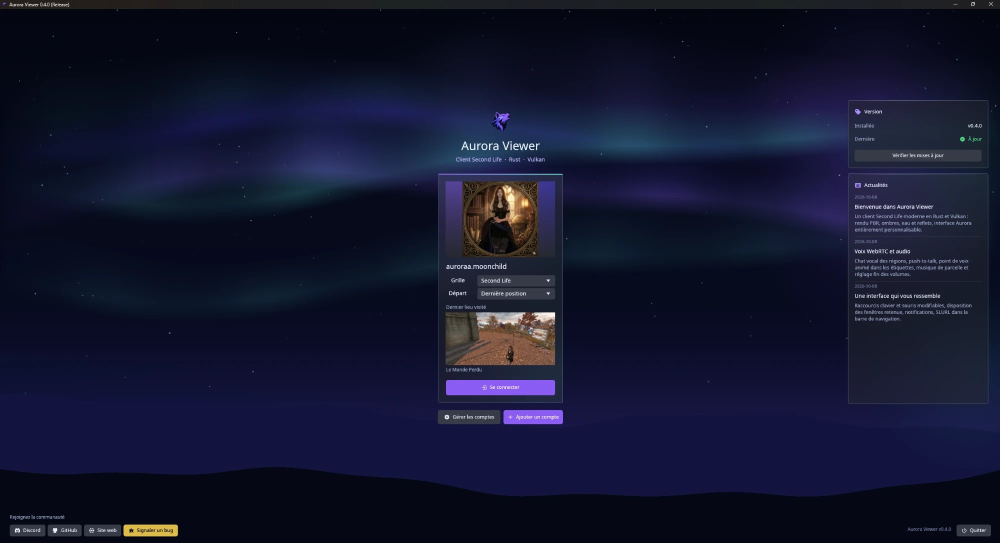

<div align="center">


# Aurora Viewer

**A modern Second Life viewer written in Rust.**

[](https://github.com/Aurora-Viewer/Aurora-Viewer/actions/workflows/ci.yml)
[](https://github.com/Aurora-Viewer/Aurora-Viewer/releases)
[](LICENSE)
[](https://www.rust-lang.org)
[](#build)

[Français](#en-français) · [Aurora vs Firestorm](#how-aurora-differs-from-firestorm) · [Roadmap](#roadmap) · [Build](#build) · [Contributing](#contributing)

</div>



Aurora Viewer is a Second Life client built from scratch in Rust, with a
modern GPU renderer (wgpu on Vulkan) and a clean, flat interface. It follows
the behaviour of [Firestorm](https://www.firestormviewer.org) — same protocol,
same rules, same defaults — while rethinking the user interface. NVIDIA DLSS
upscaling and DLAA anti-aliasing are planned (see the [roadmap](#roadmap)).

> **Status:** early development (0.x). Usable for exploring, chatting and
> testing; many features are still in progress — see [TASKS.md](TASKS.md).

## How Aurora differs from Firestorm

**What it is**

- A Second Life viewer written from scratch in Rust; it is not a fork of
  the Linden or Firestorm codebase.
- It speaks the same protocol as Firestorm (same messages, capabilities,
  request rates and defaults), so the servers see a well-behaved, familiar
  client.
- Open source (GPL-3.0-or-later), with credit to the Linden / Firestorm code
  it ports logic from (see [NOTICE.md](NOTICE.md)).

**Rendering engine**

- Vulkan (through wgpu) instead of OpenGL.
- The GPU does the heavy lifting: it decides what is visible (culling in
  compute shaders) and builds its own draw lists.
- Bindless textures and multi-draw-indirect let thousands of objects be
  drawn in a handful of calls.
- A dedicated render thread draws frame N while the main thread already
  prepares frame N+1.
- Texture and mesh decoding runs on background threads and writes straight
  into GPU staging memory, so arriving in a busy region doesn't freeze the
  picture.
- Same look as Firestorm: PBR and legacy materials, EEP sky, shadows,
  reflection probes, mirrors, water, glow and particles, checked side by
  side on the main grid.

**Performance**

<table>
  <tr>
    <td width="50%" align="center" valign="top">
      <br>
      <b>Firestorm</b> · 68 fps
    </td>
    <td width="50%" align="center" valign="top">
      <br>
      <b>Aurora Viewer</b> · 386 fps
    </td>
  </tr>
</table>

Measured on 10 October 2026 with the frame cap off, on one PC (RTX 4090), in
one busy store of about 16,000 objects. This is an informal test, not a
benchmark:

- 138 fps where Firestorm gave 68 fps at the same spot;
- about 343 fps at that spot (median) once the render thread landed, 386 fps
  in the capture above.

The texture memory budget is set automatically from the detected VRAM.

**Interface**

- A flat, modern interface of our own: a single top bar, a notification
  center, searchable conversations and a redesigned performance window.
- Teleport and loading screens show the blurred last view and real
  step-by-step progress.
- Teleports within the same region are instant, with no loading screen.
- Movement keys adapt to the keyboard layout on first launch (WASD or ZQSD).
- Interface en français et en anglais : détection du système, choix enregistré
  dans les Préférences et changement immédiat. Les catalogues Fluent permettent
  d'ajouter une langue ; voir [le guide de traduction](docs/TRANSLATING.md).
- Double-clic sur le titre d’une fenêtre pour la replier en barre déplaçable,
  puis la restaurer avec ses dimensions et son contenu.
- À la fermeture : dialogue sur fond flouté avec Quitter, Déconnecter vers
  l’écran de connexion et Annuler. Échap annule ; la déconnexion est attendue
  avant de fermer le viewer.

**Things Firestorm doesn't have**

- Link safety check: web links in chat and profiles are marked trusted,
  unknown or dangerous, judged locally with nothing sent anywhere.
- Parcel permission icons show everything, green for allowed and red for
  forbidden; Firestorm shows only the restrictions.
- HUDs can be moved directly with Alt + drag (the key is configurable),
  without opening the build tools. Hold the same key and scroll over a HUD
  to resize it locally (Shift gives finer steps), including no-modify HUDs.
  Sizes from 10% to 800% are saved per account by inventory name and creator,
  then restored on new copies. Right-click a HUD to reset its size to 100%
  or forget its saved size (the current copy keeps its size).
  While editing a HUD, scrolling without the HUD key zooms the entire HUD
  view, revealing off-screen HUDs while keeping their saved local sizes.
- Local chat bubbles show the speaker's profile picture.
- The remembered password is kept in Windows Credential Manager, as a hash
  only.
- An offline demo mode simulates a server locally, so the viewer can be
  tested with no account and no grid connection.

## What works today

- **Rendering** — wgpu / Vulkan, bindless textures, multi-draw-indirect,
  PBR and legacy materials, shadows, reflection probes, water, glow,
  particles, GPU occlusion (experimental).
- **Avatars** — skeleton and Bento animations blended like Firestorm,
  server bakes, shape, rigged mesh, complexity limits, impostors, look-at.
- **World** — prims, sculpts, mesh with LOD, terrain, EEP environment,
  world sounds, parcel music, media on prims.
- **Social** — local chat, IMs and groups, people list, blocking,
  notifications, voice (WebRTC).
- **Interface** — flat Aurora theme, Phosphor icons, mini-map and world map,
  inventory, preferences, debug overlays.
- **Windows updates** — release checks, cancellable verified downloads,
  installation and restart with rollback. The prompt explains whether cache
  and settings will be preserved, migrated or reset.



## Signaler un bug pendant l’alpha

L’icône de bug dans la barre du haut, le menu Aide, l’écran de connexion et
le bouton « Envoyer un rapport de plantage » après un crash ouvrent le même
formulaire. Après un crash, les données viennent de la session arrêtée.
Décrivez le problème et vérifiez les informations
de l’onglet Données ; décochez celles que vous souhaitez garder privées.
L’interface suit la langue choisie, même avec le formulaire ouvert. La capture
et les diagnostics filtrés sont facultatifs. Le fichier destiné à GitHub utilise
des rubriques anglaises ; votre description garde la langue de votre saisie.
Un nouveau rapport s’ouvre sur Description. Fermer puis rouvrir le formulaire
reprend le brouillon au même endroit jusqu’à l’envoi ou la fermeture du viewer.
Dans le mode navigateur, cliquez sur « J’ai publié le rapport » après la
publication sur GitHub pour commencer un autre rapport.
Après une capture prise dans Aurora, cocher ou décocher « Inclure l’interface »
reprend automatiquement la photo ; les fichiers importés restent inchangés.

Deux modes, tous deux avec un compte GitHub : « Envoyer depuis Aurora »,
présenté en premier et sélectionné par défaut, ou ouvrir une issue préremplie
dans le navigateur. L’envoi depuis Aurora demande d’autoriser son application
GitHub ; l’autorisation reste uniquement en mémoire
jusqu’à la fermeture du viewer ou sa déconnexion ; aucune publication ne suit
automatiquement l’autorisation. Sans compte, enregistrez une copie locale.

L’envoi depuis Aurora publie l’image choisie sur auroraviewer.com et l’affiche
dans l’issue. Une option distincte de l’onglet Données, décochée par défaut,
permet de joindre le ZIP des journaux aux développeurs ; son lien demande une
connexion GitHub autorisée dans le dépôt privé. Les fichiers restent dans le
Cellar privé. Un envoi interrompu peut être terminé sur la même issue.
Dans le navigateur, ajoutez l’image manuellement depuis le dossier `public`.
Si le texte est trop long pour un lien, Aurora le copie intégralement pour le
coller dans GitHub. Ne publiez jamais le dossier `private-do-not-upload`.
Le bouton de barre se masque dans Préférences › Interface.

Test hors ligne : `AURORA_DEMO=1` et `AURORA_DEMO_BUG_REPORT=1` ouvrent un rapport
exemple ; l’envoi est simulé et le navigateur reste fermé. Voir
[TESTING.md](docs/TESTING.md) et la [configuration GitHub](docs/BUG_REPORTING.md).

## Roadmap

**Not there yet**

- Search, snapshots, gestures, RLVa, the shape and clothing editors, group
  profiles, and the full sky / water editors.
- Voice is WebRTC only (no Vivox).
- Linux and macOS builds: the code is portable but not validated.

**Planned**

- NVIDIA DLSS upscaling and DLAA anti-aliasing.
- Frame Generation (under investigation).
- Faster texture loading: a GPU-compressed texture cache, so revisited
  places skip JPEG2000 decoding, and about 4× less VRAM per texture.
- PBR terrain, projector lights and a full pass on water rendering.
- Maybe a VR mode with controller support.

The detailed list of what is done, in progress and to do is in
[TASKS.md](TASKS.md).

## Build

Requirements: Windows 10/11, [Rust](https://rustup.rs) (stable, selected
automatically by `rust-toolchain.toml`), a GPU with Vulkan support.

**Development environment:** create a folder for the project, clone this
repository into it, then double-click **`aurora-tools.cmd`**:

```bat
git clone https://github.com/Aurora-Viewer/Aurora-Viewer aurora-viewer
```

The tools check the environment and offer to **repair** it: they install
whatever is missing (GitHub CLI, the Visual Studio C++ tools, Rust), clone
the Firestorm sources next to the repository, and download the emoji font,
the Rust toolchain and the crates. Then, driven by the keyboard: release /
dev / debug viewers, demo, agents' tasks, disk, logs, live pull requests with
Windows notifications, releases (see
[HUMANS.md](HUMANS.md)).

Without Git yet, this command (in a command prompt, in the project folder)
installs everything, Git included:

```bat
powershell -NoProfile -ExecutionPolicy Bypass -Command "$f = Join-Path $env:TEMP 'aurora-setup.ps1'; irm https://raw.githubusercontent.com/Aurora-Viewer/Aurora-Viewer/main/scripts/setup.ps1 -OutFile $f; & $f"
```

Or by hand, to build the viewer only:

```powershell
git clone https://github.com/Aurora-Viewer/Aurora-Viewer aurora-viewer
cd aurora-viewer
./scripts/fetch-assets.ps1          # emoji font (too large for git)
cargo build --release -p aurora-viewer
./target/release/aurora-viewer.exe
```

Run the same checks as the CI with `./scripts/check.ps1` (rustfmt, clippy
with warnings as errors, tests). Day-to-day development uses the default
profile (`cargo run -p aurora-viewer`): it behaves like the release build
without its slow link-time optimization. `./scripts/build-release.ps1`
builds GitHub's latest `main` with `--release` into `..\RELEASE\`.

Le **tag Git est la référence de la version du viewer** : `v0.2.0` donne
`0.2.0` partout (titre, interface, journaux et clients réseau). Entre deux
tags, `0.2.0+7.gabcdef123` indique le nombre de commits et l'identifiant
court. La version des crates dans `Cargo.toml` ne sert pas de numéro au
viewer. Une archive de sources sans Git peut être compilée avec
`AURORA_VERSION_TAG=v0.2.0` ; sinon elle s'identifie comme
`0.0.0+0.gunknown`. Le workflow Release contrôle la version annoncée par
l'exe avant publication ; le build local la note aussi dans `version.txt`.

### Command line

| Argument | Effect |
|---|---|
| `--title <text>` | Names the window "Aurora Viewer <version> - <text> (Dev)" and its log file |
| `--fps-limit <fps>` | Caps this instance at 1–500 fps without changing saved preferences |
| `--language <code>` | Force la langue de cette instance (`en`, `fr`, ou une autre langue ajoutée aux catalogues), sans modifier le choix enregistré |
| `-h`, `--help` | Shows the help |
| `-V`, `--version` | Affiche la version compilée puis quitte, sans fenêtre, journal ni réseau |

- `--title`: the build profile ends the title (Dev, Release, Debug); the log
  file is `aurora-<text>.log` (`aurora-demo-<text>.log` in demo mode).
- `--fps-limit`: applies an extra limit to this process, including captures
  and online sessions; a lower user preference remains effective.
- `--language` : accepte aussi `--language=fr`. Une langue non disponible
  utilise l'anglais ; l'argument est destiné aux démos et aux captures.

Le viewer suit d'abord la langue enregistrée dans **Préférences › Interface ›
Langue**, puis celle du système si « Langue du système » est sélectionné.
L'anglais sert de repli. Le changement s'applique immédiatement ; le réglage
« Langue visible aux scripts » est activé par défaut, comme Firestorm.
Les traductions se trouvent dans `crates/aurora-i18n/locales/` :
[guide de traduction](docs/TRANSLATING.md).

The frame limiter is enabled at **120 fps by default** and can be disabled
or adjusted in Préférences › Graphismes › Fluidité. Saved preferences are
preserved.

### Animation Overrider (AO)

Le bouton **AO** de la barre du bas ouvre la gestion de l’Animation Overrider intégré. Les ensembles sont conservés sous `#Firestorm/#AO` ; importez une notecard ZHAO depuis le même dossier que ses animations. L’AO est désactivé initialement, comme dans Firestorm. `cao on` / `cao off` l’activent ou le désactivent ; `cao sit` bascule l’assise, `cao sit off` remplace l’assise et `cao sit on` conserve l’assise standard, comme Firestorm. Le scénario de démo est décrit dans [les options de test](docs/TESTING.md#avatars-et-animations).

### Notecards

Les notes affichent les images, repères et autres éléments intégrés avec leur
icône et leur nom dans le texte. Glisser un élément depuis l’inventaire pour
l’insérer ; un clic gauche l’ouvre directement, et le clic droit propose
Ouvrir ou Copier dans l’inventaire. Enregistrer (Ctrl+S) conserve leurs
permissions.
Les scénarios de démo sont décrits dans
[le guide de test](docs/TESTING.md#interface).

### Test switches

Local and editing HUD zoom scenarios (`AURORA_DEMO_HUDS=scale|scale-copy|scale-touch|scale-reset|scale-forget|scale-ctrl|scale-key|scale-secondary|edit-scroll`)
are described in [the testing guide](docs/TESTING.md#huds).

The offline **demo mode** simulates a server locally (a plaza, avatars,
objects, chat, notifications…): no connection, no account. It keeps its own
settings and cache (`…\config\demo`, `…\cache\demo`).

```powershell
$env:AURORA_DEMO = "1"
cargo run -p aurora-viewer
```

| Variable | Effect |
|---|---|
| `AURORA_DEMO=1` | Offline demo mode |
| `AURORA_DEMO_REPLACE_PRIM=1` | A 15-part board and an independent replacement; combine with `AURORA_DEMO_BUILD=replace-button\|replace-edit\|replace-run\|replace-copy,object:99688` |
| `AURORA_DEMO_<NAME>=…` | A demo scenario: a window, a stress scene, a camera script… |
| `AURORA_DEMO_PIE=1` / `0` | Force le menu circulaire / en liste dans la démo, sans modifier la préférence ; à combiner avec `AURORA_DEMO_RCLICK` |
| `AURORA_CAPTURE=<file.png>` | Saves a capture of a frame |
| `AURORA_PROFILE=1` | Writes one profiling line per second to the log |

The full list of switches (demo scenarios, captures, forced settings,
diagnostics) and how to read the profiling output are in
[docs/TESTING.md](docs/TESTING.md) (in French).

Logs are in `%LOCALAPPDATA%\Aurora\AuroraViewer\data\logs\`.

## Contributing

This repository is worked on by humans together with AI agents, each agent on
its own task in its own git worktree:

- [AGENTS.md](AGENTS.md) — rules for AI agents (testing, safety, PRs, reviews)
- [HUMANS.md](HUMANS.md) — how the repository works for humans
- [ARCHITECTURE.md](ARCHITECTURE.md) — scope, crates and file layout
- [TASKS.md](TASKS.md) — what is done, in progress and to do
- [docs/BRANDING.md](docs/BRANDING.md) — palette, logos, icons and UI rules
- [docs/TESTING.md](docs/TESTING.md) — test switches (demo scenarios,
  captures, diagnostics) and profiling

Behaviour follows Firestorm: its sources are expected next to the repository
(`../phoenix-firestorm`, cloned from
[FirestormViewer/phoenix-firestorm](https://github.com/FirestormViewer/phoenix-firestorm)).

## License

Aurora Viewer is free software under the
[GNU General Public License v3.0 or later](LICENSE). Parts of it are ported
from the Second Life viewer and Firestorm (originally LGPL 2.1); see
[NOTICE.md](NOTICE.md) for details and third-party licenses.

Aurora Viewer is not affiliated with Linden Lab or the Firestorm project.
Second Life® is a trademark of Linden Research, Inc.

---

## En français

**Aurora Viewer** est un viewer Second Life moderne écrit en Rust : rendu GPU
récent (wgpu / Vulkan), interface plate et soignée, et un comportement fidèle
à Firestorm (mêmes messages, mêmes règles, mêmes valeurs par défaut).

- **Ce qui le distingue de Firestorm :** un moteur écrit de zéro, piloté par
  le GPU, et une interface repensée ; voir
  [How Aurora differs from Firestorm](#how-aurora-differs-from-firestorm) et
  la [feuille de route](#roadmap).
- **Compiler :** voir [Build](#build) ci-dessus (Windows, Rust stable).
- **Tester sans compte :** `AURORA_DEMO=1` lance un mode démo hors ligne ;
  la liste des options est dans [docs/TESTING.md](docs/TESTING.md).
- **Contribuer :** le dépôt est pensé pour des humains travaillant avec des
  agents IA ; lis [HUMANS.md](HUMANS.md) (humains) et
  [AGENTS.md](AGENTS.md) (agents). Le suivi des tâches est dans
  [TASKS.md](TASKS.md).
- **Licence :** GPL-3.0-or-later, voir [NOTICE.md](NOTICE.md).
