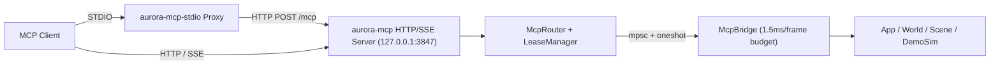

# Aurora MCP Runtime Server & Viewer Bridge

> **Fork Feature (`drakkhis/Aurora-Viewer` · `feat/aurora-mcp`)**
> This document describes the native Rust **Model Context Protocol (MCP)** subsystem added in this fork. For the main Aurora Viewer documentation, see the [README](../README.md).

## Overview

This branch implements an optional, native Rust **Model Context Protocol (MCP)** subsystem for **Aurora Viewer**, consisting of:

1. **[`crates/aurora-mcp`](../crates/aurora-mcp/src/lib.rs):** An asynchronous JSON-RPC 2.0 MCP server supporting both HTTP/SSE (`http://127.0.0.1:3847/mcp`, `/sse`, `/message`, `/health`) and standard I/O via the standalone [`aurora-mcp-stdio`](../crates/aurora-mcp/src/bin/stdio_proxy.rs) proxy binary.
2. **[`crates/aurora-viewer/src/mcp_bridge.rs`](../crates/aurora-viewer/src/mcp_bridge.rs):** A main-thread bridge integrated into [`App`](../crates/aurora-viewer/src/app.rs) that drains MCP requests within a strict **`1.5ms` per-frame budget** (`MCP_FRAME_BUDGET`) so external tool calls never degrade the viewer's frame rate.

---

## Architecture & Key Subsystems



- **100% Legacy Viewer MCP Parity + Aurora-Native Catalog (`111` Tools Total):**
  - **43 Legacy Viewer MCP parity tools (`AURORA_MCP_PROFILE=compact` lists the 35 core compact tools; `full`/default lists all 111):**
    - *Control & Session (4):* `control_acquire`, `control_release`, `connection_status`, `capabilities_refresh`.
    - *Introspection & Events (5):* `viewer_api_inspect`, `viewer_call`, `events_subscribe`, `events_read`, `events_unsubscribe`.
    - *Avatar Locomotion (4):* `avatar_position`, `avatar_walk_to`, `avatar_movement_status`, `avatar_stop`.
    - *Camera & Viewport (3):* `camera_set`, `camera_release`, `mesh_preview_camera`.
    - *Scene, Settings & Capture (6):* `world_objects`, `setting_get`, `setting_set`, `snapshot`, `capture_orbit`, `capture_manifest_read`.
    - *Inventory & Assets (3):* `inventory_search`, `asset_inspect`, `image_compare`.
    - *Native Dialogs & File Selection (2):* `native_file_dialogs`, `native_file_choose`.
    - *Floaters & Menus (4):* `floater_list`, `floater_open`, `ui_list_menus`, `ui_invoke_menu`.
    - *Mesh Importer & Local Mesh (5):* `local_mesh_open`, `local_mesh_status`, `local_mesh_auto_reload`, `mesh_upload_open`, `mesh_upload_status`.
    - *UI Introspection & Interaction (7):* `ui_inspect`, `ui_find`, `ui_click`, `ui_get_value`, `ui_set_text`, `ui_select`, `ui_press_key`.
  - **68 Aurora-Native Creator & Simulation Tools (`full` / default profile):**
    - *Agent & Radar (3):* `get_agent_status`, `radar_scan_avatars`, `radar_scan_objects`.
    - *Chat & Comms (2):* `comms_read_history`, `comms_send`.
    - *Navigation & Teleport (1):* `nav_move_and_teleport`.
    - *Avatar Animations (3):* `avatar_animation_play` (named emotes and custom UUIDs), `avatar_animation_stop`, `avatar_animations_list`.
    - *Economy & Account (3):* `economy_get_balance`, `economy_pay_avatar` (resident L$ transfers), `economy_pay_object` (object/tip jar/vendor L$ payments).
    - *Social & Groups (3):* `groups_list` (memberships, roles, and active group), `groups_activate` (switch active group title/tag), `friends_list` (friend roster, online status, and permissions).
    - *Land, Parcel & Estate (5):* `parcel_info` (parcel limits, flags, owner/group, ground height, and estate manager overrides), `parcel_set_music` (audio streaming update and auto-play), `parcel_set_properties` (name, desc, flags), `parcel_access_list_modify` (whitelist/blacklist updates), `parcel_eject` (avatar removal with optional ban).
    - *Environment / EEP Suite (3):* `environment_get` (sky & water inspection), `environment_set_time` (preset/time of day override with automated rollback), `environment_apply_preset` (inventory EEP asset override and reset to shared).
    - *Spatial WebRTC Voice Suite (5):* `voice_status` (connection state, channel type, ear mode, microphone level), `voice_participants_list` (residents in voice range, active speaking flags, volume levels), `voice_set_user_volume` (individual playback volume sliders), `voice_set_user_mute` (local muting), `voice_transmit` (avatar push-to-talk microphone state).
    - *RLVa Protocol Execution (1):* `rlva_execute` (runs internal RLVa commands like `@version`, `@getstatus`, `@sit`).
    - *Settings & Camera (3):* `settings_query`, `settings_set`, `camera_control`.
    - *Bento IK Poser (3):* `poser_inspect` (inspects 359 bones), `poser_set_bones` (Euler overrides with automatic rollback), `poser_reset`.
    - *Vision & Viewport Capture (1):* `viewport_capture` (`color_rgb` and `depth_normalized` with Kaolin/Three.js-ready calibration).
    - *Inventory & Appearance (4):* `inventory_browse`, `inventory_rez_object`, `appearance_get_worn`, `appearance_mutate` (serialized COF queue).
    - *Asset Pipeline & LiveMesh (2):* `asset_upload` (stage/quote/upload/clear with `include_textures`, `include_skin_weights`, `include_joint_positions`, `lock_scale`, and `entry_ids`, plus `viewer_call` `Aurora.Imports.set_mesh_options`), `livemesh_control` (headless streaming of LODs and textures directly into the importer).
    - *Linkset Data Suite (3):* `lsd_inspect`, `lsd_mutate`, `lsd_stress_test` (128 KiB quota, HMAC passphrase protection).
    - *Object Building & Manipulation (8):* `prim_rez_new`, `prim_transform`, `prim_set_shape`, `prim_link`, `prim_delete`, `object_take_or_derez`, `prim_set_physics_properties` (phantom, physical, temporary, collision shape types, and `animated_mesh` / `viewer_call` `Aurora.Build.set_animated_mesh` Animesh toggle), `prim_set_metadata` (name and description).
    - *Material & Particle Systems (2):* `prim_set_material` (PBR/Blinn-Phong face texturing), `prim_set_particles` (real-time particle system generation and script injection).
    - *Interaction & Seating (2):* `object_touch` (raycast face/UV/ST grabs), `avatar_sit` (prim seating and stand up).
    - *Task & User Notecards (2):* `notecard_read`, `notecard_write` (enforces modify/copy permissions and RLVa `@viewnote`).
    - *LSL/SLua Script Lifecycle (4):* `lsl_inspect_object_scripts`, `lsl_read_script`, `lsl_write_and_compile` (supports `compile_target`: `mono`, `lsl2`, `luau`, `lsl_luau`), `lsl_listen_script_output`.
    - *Control Leases (2):* `viewer_control_acquire`, `viewer_control_release`.
    - *Autonomous Login & Shutdown (2):* `viewer_login`, `viewer_shutdown`.
    - *Local Asset Inspection (1):* `asset_inspect_local`.
  - Supports `AURORA_MCP_PROFILE=compact` (35 core tools) and `AURORA_MCP_PROFILE=full` (default; all 111 tools listed directly in `tools/list`), while `tools/call` dispatches all 111 tools in both profiles.

- **Realtime Server-Sent Events (SSE) Push Streaming (`/sse`):**
  - An asynchronous broadcast channel (`broadcast::Sender<String>`) streams in-world events (chat, IMs, script debug output, touches, radar movements) directly to connected HTTP clients as JSON-RPC 2.0 notifications (`method: "notifications/message"`), eliminating polling overhead for AI agents.

- **Cooperative Lease & Automatic Rollback Stack ([`lease.rs`](../crates/aurora-mcp/src/lease.rs)):**
  - Mutations to viewer settings, camera transforms, Bento Poser joints, and environment presets push their pre-lease state onto the active lease's rollback stack (`RollbackAction::RestoreSetting`, `RestoreCamera`, `ResetPoser`, `RestoreEnvironment`) and restore them automatically when `control_release` / `viewer_control_release` is called or when a lease expires.

- **Linkset Data (LSD) Suite ([`lsd.rs`](../crates/aurora-mcp/src/lsd.rs)):**
  - Implements the `131,072`-byte (`128 KiB`) per-linkset KVP store with LSL return codes (`LINKSETDATA_OK`, `LINKSETDATA_EMEMORY`, `LINKSETDATA_EPROTECTED`, `LINKSETDATA_ENOKEY`, `LINKSETDATA_NOUPDATE`), HMAC-SHA256 passphrase protection (`llLinksetDataWriteProtected`), regex key filtering, and offline payload stress-testing (`lsd_stress_test`) against the 128 KiB LSD ceiling and 32 KiB Mono string limit.

- **Creator Permission Enforcement (`AGENTS.md` §2):**
  - Inventory serialization ([`serialize_inventory_item`](../crates/aurora-viewer/src/mcp_bridge.rs)) enforces `asset_uuid_shown` and `agent_mask`.
  - LSL script reading and writing enforce `task_agent_mask` (`perm::MODIFY | perm::COPY` for source reads; `perm::MODIFY` for writes) as well as RLVa `@viewscript` restrictions.
  - Notecard reading and writing enforce `perm::MODIFY | perm::COPY` and RLVa `@viewnote` restrictions.

---

## How to Launch & Connect

- **Start Aurora Viewer with MCP enabled (default port `3847`):**
  - **Linux / macOS:**
    ```bash
    cargo run --bin aurora-viewer -- --mcp
    # Or specify a custom port / environment variables:
    AURORA_MCP=1 AURORA_MCP_PROFILE=full cargo run --bin aurora-viewer -- --mcp-port=3847
    ```
  - **Windows (PowerShell):**
    ```powershell
    cargo run --bin aurora-viewer -- --mcp
    # Or specify a custom port / environment variables:
    $env:AURORA_MCP = "1"
    $env:AURORA_MCP_PROFILE = "full" # or "compact"
    cargo run --bin aurora-viewer -- --mcp-port=3847
    ```
- **Connect via HTTP/SSE:**
  - JSON-RPC POST endpoint: `http://127.0.0.1:3847/mcp`
  - SSE stream endpoint: `http://127.0.0.1:3847/sse`
  - Health endpoint: `http://127.0.0.1:3847/health`
- **Connect via STDIO (for MCP clients that spawn a command):**
  - Build and point your MCP client at `target/debug/aurora-mcp-stdio` (or `target\debug\aurora-mcp-stdio.exe` on Windows), which forwards stdin/stdout JSON-RPC to `http://127.0.0.1:3847/mcp`.

---

## Verification

- **Workspace Unit & HTTP Integration Tests:**
  ```bash
  cargo test --workspace mcp
  ```
- **Live End-to-End in `DemoSim`:**
  Run with `AURORA_DEMO=1` and `AURORA_DEMO_POSER=1` alongside `--mcp` to exercise all 111 tools offline without connecting to a live grid.
